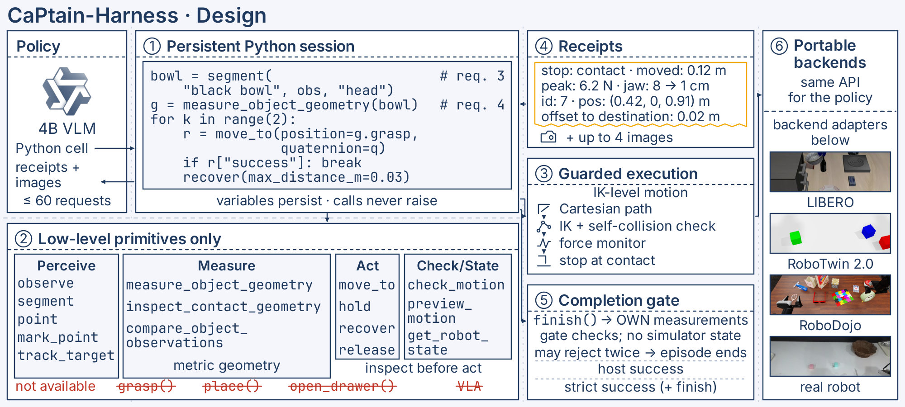

<div align="center">
# CaPtain-Harness

**One low-level robot API for code-as-policy agents: run any OpenAI-compatible model on LIBERO-family, RoboTwin 2.0, RoboDojo, SimplerEnv, CaP-Bench and real robots**

[](https://github.com/waltstephen/CaPtain)
[](#)
[-orange)](#)
[](LICENSE)




</div>

## What is CaPtain-Harness

CaPtain-Harness is an environment for **code-as-policy (CaP) robot agents**. A vision-language model controls a robot by
writing Python against a fixed set of low-level perception and motion primitives. It reads the receipts of its own robot
calls and decides when the task is done. The model talks to the harness through a standard OpenAI-compatible chat API,
so a frontier model, an open model or your own checkpoint can be evaluated or trained on the same tasks.

- **One tool, one API.** The model has one tool, `python`: a persistent, sandboxed Python 3.11 session. Its robot API has
  22 low-level capabilities (perception, geometric measurement, IK-level guarded motion) plus `finish()`. There are no
  grasp or place macros and no VLA. Every call returns a one-line text receipt, and calls never raise.
- **Hidden state stays on the host.** The model sees images, its own code and output, and receipts. Object poses, contacts
  and the success predicate never leave the host process. The episode is scored once, on the final state.
- **Portable backends.** LIBERO (and LIBERO-PRO / Plus / MAX), RoboTwin 2.0, RoboDojo, SimplerEnv and CaP-Bench all use the
  same tools, receipts and TASK.md format. A hardware backend runs the same API on real robot arms through a small driver
  interface.
- **Built for training too.** Budgets are enforced in the server. Episodes are written as complete, replayable transcripts.
  Default-off hooks log host-only per-request state for RL credit assignment.

CaPtain-Harness was used to train and evaluate **CaPtain-4B**, a Qwen3.5-4B model post-trained with SFT and RL. The SFT and
RL pipeline, the simulator critic and the paper results are in the [CaPtain repository](https://github.com/waltstephen/CaPtain),
which includes this repository as a pinned submodule.

## News

- **[2026/10]** 🔥 CaPtain-Harness released as a standalone repository: all backends, evaluation runners, task lists, scorers,
  perception services and model download scripts.
- **Coming soon** 🤗 CaPtain-4B and CaPtain-4B-SFT on Hugging Face · 📄 paper on arXiv.

## Installation

Linux x86_64 with NVIDIA GPUs (EGL for MuJoCo; Vulkan for the SAPIEN / Isaac Sim backends), `bubblewrap` ≥ 0.5,
Python 3.10 and 3.11. Choose one installation route:

| Route | Use it when you want to… |
|---|---|
| [Harness + LIBERO](INSTALL.md#2-the-harness-environment-server-and-react-driver) | run a model on LIBERO or CaP-Bench, or develop the harness itself |
| [+ LIBERO-PRO / Plus / MAX](INSTALL.md#libero-pro--libero-plus--libero-max) | evaluate robustness to layout, task, sensor and mid-task perturbations |
| [+ transfer simulators](INSTALL.md#5-per-backend-requirements) | run RoboTwin 2.0, RoboDojo or SimplerEnv (each simulator in its own environment) |
| [+ hardware](INSTALL.md#hardware-real-robots) | drive a real robot arm through your own driver |

```bash
git clone https://github.com/waltstephen/CaPtain-Harness.git && cd CaPtain-Harness
scripts/setup_third_party.sh                                    # LIBERO @ pinned revision into third_party/
python3.10 -m venv .venv-libero && .venv-libero/bin/pip install -r requirements-libero.txt \
  && .venv-libero/bin/pip install -e third_party/libero --no-deps && .venv-libero/bin/pip install -e . --no-deps
python3.11 -m venv ~/envs/student-py311 && ~/envs/student-py311/bin/pip install -r requirements-student.txt   # the agent's sandboxed Python
```

The package is `captain-harness` (import name `captain_harness`). Install it editable, because it reads `configs/` and `data/`
from the checkout. [INSTALL.md](INSTALL.md) has the exact versions, the per-backend simulator installs, GPU / Vulkan / EGL
notes, and the extra observation inputs each backend gives the agent.

## Models Preparation

```bash
export HF_TOKEN=...                                   # only for the gated SAM 3 weights
CAPTAIN_MODELS_DIR=/data/models scripts/download_models.sh [--dry-run] [sam3 molmo2 moge policy | all]
```

| Asset | Hugging Face id | Used by | Script |
|---|---|---|---|
| SAM 3 | `facebook/sam3` (`sam3.pt`). **Gated:** accept the SAM License on its model page, then `export HF_TOKEN` | segmentation service, port 8114 (required) | `scripts/models/download_sam3.sh` |
| Molmo2-8B | `allenai/Molmo2-8B` @ `e28fa28` | pointing service, port 8122 (required) | `scripts/models/download_molmo2.sh` |
| MoGe-2 | `Ruicheng/moge-2-vitl-normal` @ `cb0e8bb` | monocular depth, port 8130 (optional: only the hardware backend, for cameras without a depth sensor) | `scripts/models/download_moge.sh` |
| CaPtain-4B / CaPtain-4B-SFT | `<hf-user>/CaPtain-4B`, `<hf-user>/CaPtain-4B-SFT` (**coming soon**) | policy, port 8600 | `scripts/models/download_policy.sh` |

The scripts can be re-run safely, print every command they run (`--dry-run` only prints), and never store tokens. You do not
need the CaPtain weights to use the harness: point it at **any OpenAI-compatible endpoint** with
`POLICY_URL=http://<host>:<port>/v1 POLICY_MODEL=<name>`. For endpoints that need a key, add `--auth bearer` and export
`CAPTAIN_API_KEY` (or `OPENAI_API_KEY`).

## Quick Start

**1. Start the services**

```bash
TOOLS_PYTHON=/path/to/capx-env/bin/python VLLM_BIN=/path/to/vllm-env/bin/vllm \
  SAM3_CHECKPOINT=$CAPTAIN_MODELS_DIR/sam3/sam3.pt MOLMO_MODEL=$CAPTAIN_MODELS_DIR/Molmo2-8B \
  services/start_perception.sh                                  # SAM 3 :8114 + Molmo2-8B :8122
services/serve_policy.sh <model dir or HF id> 8600              # vLLM, OpenAI-compatible; or use an existing endpoint
```

**2. Run one LIBERO episode**

```bash
export POLICY_URL=http://127.0.0.1:8600/v1 STUDENT_PYTHON=~/envs/student-py311/bin/python EGL_DEVICE=0
eval/run_episode.sh libero_spatial 0 11 runs/demo
cat runs/demo/libero_spatial_0_seed-11/episode_result.json      # host_final_success, agent_finished, termination_reason, ...
```

The episode directory holds exactly what the model was sent and returned (`driver/requests.jsonl`, `driver/transcript.jsonl`),
every robot call with its receipt (`calls.jsonl`), the agent's workspace and images, and host-only audit files.

**3. Run and score a benchmark**

```bash
python3 eval/run_jobs.py eval/tasks/libero_official_240.tsv --out runs/my-model --parallel 8   # resumable; retries infra errors
python3 eval/summarize.py eval/tasks/libero_official_240.tsv runs/my-model                     # host / strict success per cell
python3 eval/transfer/run_jobs.py robotwin2 <task dir> --out runs/my-model/robotwin2 --parallel 8
python3 eval/transfer/summarize.py robotwin2 runs/my-model/robotwin2
```

## Usage Guidance

| Guide | Use it when you want to… |
|---|---|
| [INSTALL.md](INSTALL.md) | install the harness, the agent Python, the services and each benchmark's simulator |
| [Harness reference](docs/harness.md) | know exactly what the model sees, the budgets, the completion gate, the episode files and the design rules |
| [LIBERO-family evaluation](docs/harness.md#reproduce-the-papers-evaluations) | run the LIBERO, LIBERO-PRO, LIBERO-Plus and LIBERO-MAX task lists with the paper protocol |
| [Transfer benchmarks](eval/transfer/README.md) | run RoboTwin 2.0, RoboDojo, SimplerEnv or CaP-Bench with their official protocols and scorers |
| [Hardware backend](docs/harness.md#hardware-backend-real-robots) | connect a real robot: driver protocol, kinematic twin, cameras, monocular depth |
| [AGENTS.md](AGENTS.md) | hand the repository to a coding agent: map, rules and checks |
| [CaPtain](https://github.com/waltstephen/CaPtain) | train your own model in this harness (SFT on agent trajectories, RL with a simulator critic) |

> 💡 **Agent tip:** pick the guide that matches your task and give it to your coding agent together with [AGENTS.md](AGENTS.md).

## Supported Backends

| Benchmark | Suite | Backend (`src/captain_harness/adapters/`) | Simulator | Embodiment |
|---|---|---|---|---|
| LIBERO | `libero_{spatial,object,goal,10,90}` | `libero` | robosuite 1.4, MuJoCo 2.3.7 | Franka Panda |
| LIBERO-PRO / Plus / MAX | same + `--libero-variant pro\|plus`, `--max-case` | `libero` + `server/libero_variants.py`, `server/libero_max_events.py` | the benchmarks' LIBERO forks | Franka Panda |
| RoboTwin 2.0 | `robotwin2_sim` | `robotwin2` | RoboTwin 2.0, SAPIEN 3 | dual Franka Panda on the official layouts |
| RoboDojo | `robodojo_sim` | `robodojo` | RoboDojo, Isaac Sim 5.1 | dual ARX X5 |
| SimplerEnv | `simplerenv_sim` | `simplerenv` | SimplerEnv, SAPIEN 2.2 | WidowX 250s (Google Robot supported) |
| CaP-Bench | `capgym_{lift,stack,restack,nut,wipe}` | `capgym` | CaP-Gym tasks rebuilt on robosuite 1.4 | Franka Panda |
| Real robots | `hardware_real` | `hardware` | your driver + a MuJoCo kinematic twin | your arm (MJCF twin + calibration profile) |

Every backend gives the agent the same kinds of measurements: RGB-D with intrinsics, measured joint and gripper state, and
a wrist force or contact signal. Where these go beyond a benchmark's official observation, it is stated per benchmark in
[INSTALL.md](INSTALL.md#5-per-backend-requirements) and [eval/transfer/README.md](eval/transfer/README.md). The agent never
receives object poses, the success predicate or task progress.

## Results with CaPtain-4B

CaPtain-4B was trained only on LIBERO, in this harness. Success rates in % (host = goal predicate on the final state; strict
= host and the agent called `finish()` itself). The full results and comparisons are in the
[CaPtain repository](https://github.com/waltstephen/CaPtain).

| Benchmark | Protocol | CaPtain-4B-SFT | **CaPtain-4B** |
|---|---|:-:|:-:|
| LIBERO | official held-out states 11–16, 240 episodes (host / strict) | 55.4 / 52.1 | **73.8 / 67.5** |
| LIBERO-PRO Pos+Task | 6-cell mean, 600 episodes | 59.5 / 56.7 | **78.5 / 71.5** |
| LIBERO-Plus | 7 categories, 700 episodes | 48.6 / 44.6 | **66.1 / 59.0** |
| LIBERO-MAX | Dynamic / Base, host | 40.0 / 51.2 | **61.2 / 70.0** |
| RoboTwin 2.0 | official Hard, 50 tasks × 100 (zero-shot) | – | **22.6** |
| SimplerEnv | WidowX visual matching, 4 × 24 (zero-shot) | – | **83.3** |
| CaP-Bench | Cube Lift + Cube Stack at CaP-Gym's horizon (zero-shot) | – | **75.0** |
| RoboDojo | 42 tasks, leaderboard Score (zero-shot) | – | **1.7** |

## For AI agents

> 🤖 This section is for the coding agent you hand this repository to. [AGENTS.md](AGENTS.md) holds the same rules in more detail.

- **Entry points.** One episode: `eval/run_episode.sh <suite> <task_id> <seed> <out_dir>`, or
  `eval/transfer/run_episode.sh <benchmark> <task.json> <out_root>`. A task list: `eval/run_jobs.py` /
  `eval/transfer/run_jobs.py`. Scoring: `eval/summarize.py` / `eval/transfer/summarize.py`. Models: `scripts/download_models.sh`.
- **Where things live.** The ReAct loop, context compaction and model client are in `src/captain_harness/react/`. One
  episode (budgets, completion gate, receipt plumbing) is `src/captain_harness/server/`. The robot API and backends are in
  `src/captain_harness/adapters/`, with contracts in `ports/`. Services are in `services/`, configs in `configs/`.
- **Invariants.**
  1. `react` must not import `server` or `adapters` and must not use robot or task vocabulary (`tests/test_import_boundaries.py`).
  2. Hidden state stays hidden. Nothing served to the model carries poses, contacts or the success predicate, and the
     episode output directory is hidden from the sandbox.
  3. Budgets (request cap, wall time, action budget) are enforced in the server.
  4. When evaluating the CaPtain checkpoints, do not change model-visible text (TASK.md, tool descriptions, receipts,
     the request template).
  5. Never hard-code paths, hosts or keys; they come from environment variables.
- **Adding a backend or robot.** Add a backend under `adapters/` that exposes the same capability manifest, register its
  suite, add a task list, and run `pytest tests/test_transfer_wiring.py`. For a real arm, implement the driver protocol in
  `adapters/hardware/facade.py`.
- **Checks.** `.venv-libero/bin/python -m pytest -q tests/test_react_*.py tests/test_server_env_server.py tests/test_import_boundaries.py tests/test_transfer_wiring.py` (CPU, seconds).

## License

CaPtain-Harness is released under the [MIT License](LICENSE). Upstream components (LIBERO, CaP-X, SAM 3, Molmo2, MoGe, the
benchmarks and their simulators) keep their own licenses; see [THIRD_PARTY_LICENSES.md](THIRD_PARTY_LICENSES.md). SAM 3
weights fall under the SAM License and are not redistributed. Known limitations: [RELEASE_NOTES.md](RELEASE_NOTES.md).

## Citation

If you use CaPtain-Harness, please cite:

```bibtex
@article{fan2026captain,
  title   = {CaPtain: A Pipeline for Post-Training Code-as-Policy Robot Agents},
  author  = {Fan, Yijia and He, Xilin and Jiang, Yilei and Wu, Dongming and Wang, Jiaxu and Yue, Xiangyu},
  journal = {arXiv preprint},
  year    = {2026}
}
```

## Contact

Questions and issues: open a GitHub issue, or contact the corresponding author, Xiangyu Yue (xyyue@ie.cuhk.edu.hk).
